# Générateur EDT (AGEMP)

Web application that automatically generates university timetables (*emplois du temps*) for a section, from its modules, teachers, rooms and time slots, and lets administrators, teachers and students manage and view them. Built by a team of four as a university project.

## Features

- Role-based access (administrator, teacher, student) with JWT cookie authentication
- CRUD management of specialities, sections, groups, modules, rooms (amphitheatres, TD and TP rooms), sessions and time slots
- Teacher availability: occupied slots and preferred time slots
- **Timetable generation** per section and semester, configurable by constraints: start/end time, slot length, break between slots, max consecutive sessions, max lectures per day, optional shuffling
- Export of timetables to Excel (`exceljs`) and sending by email
- CLI script to create the first administrator account

## Screenshots

**Login**: one entry point for administrators, teachers and students.

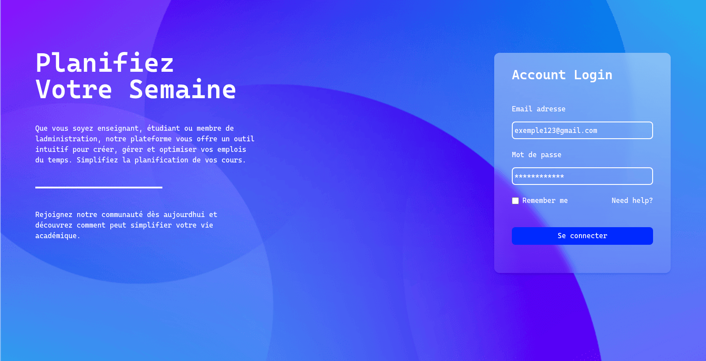

**Administration**: manage students, teachers, modules, rooms, sections and groups.

| | |
| --- | --- |
|  |  |
| Students | Teachers |
| 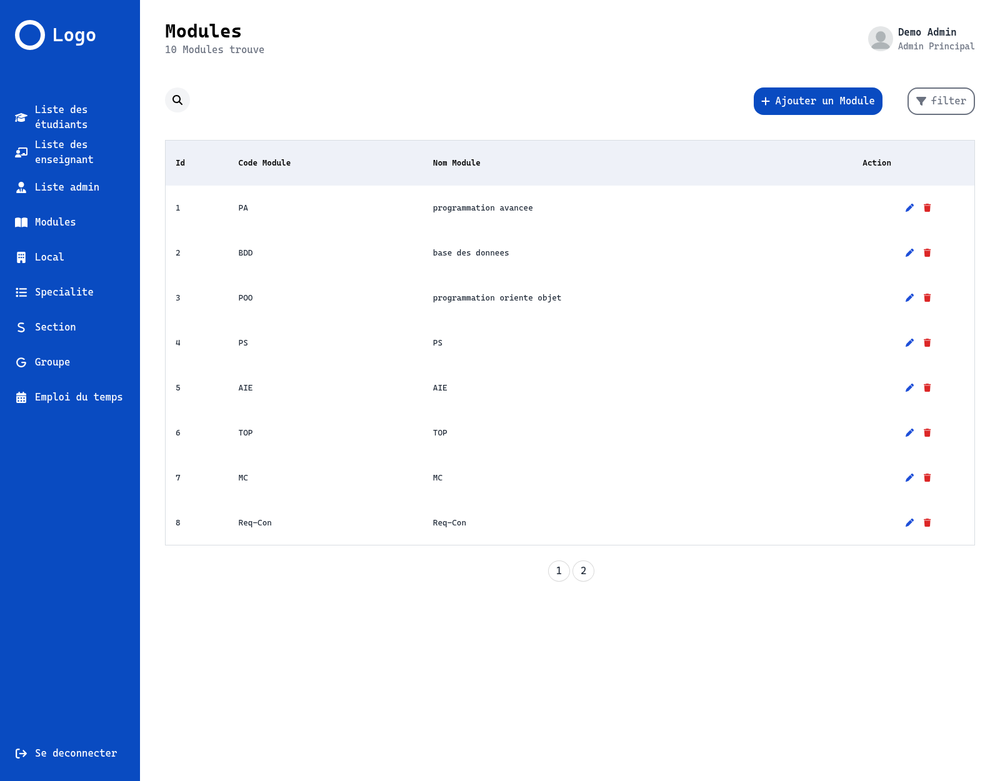 | 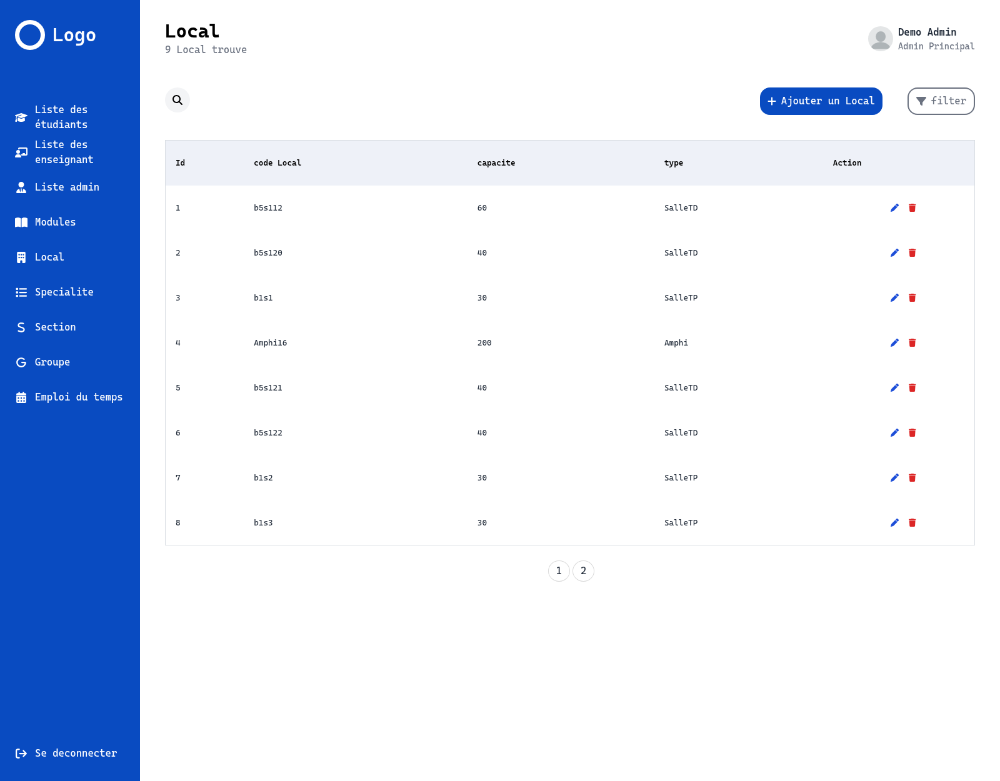 |
| Modules | Rooms |
|  | 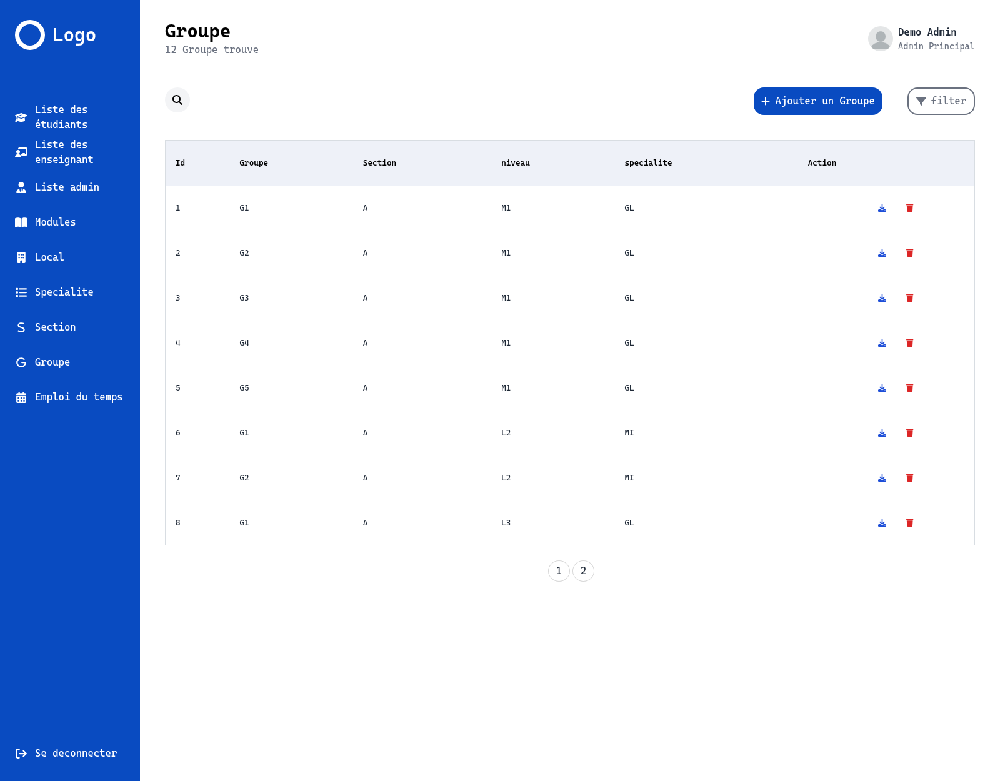 |
| Sections | Groups |

**Timetable generation**: pick the year, semester, level and speciality, set the constraints (start/end time, session length, break, ignore teacher load), then press "+" on a section to generate it.

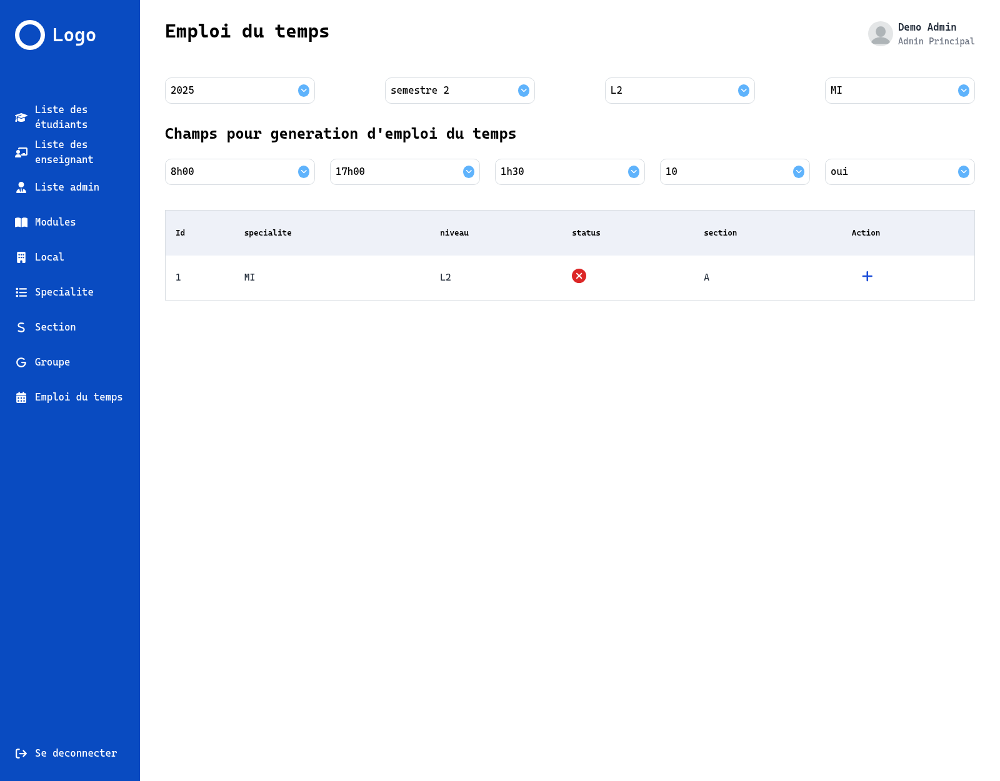

The generator proposes a timetable for every group of the section (teachers, rooms and conflicts are handled for you). Each module has its own color. Review it, then approve it to save.

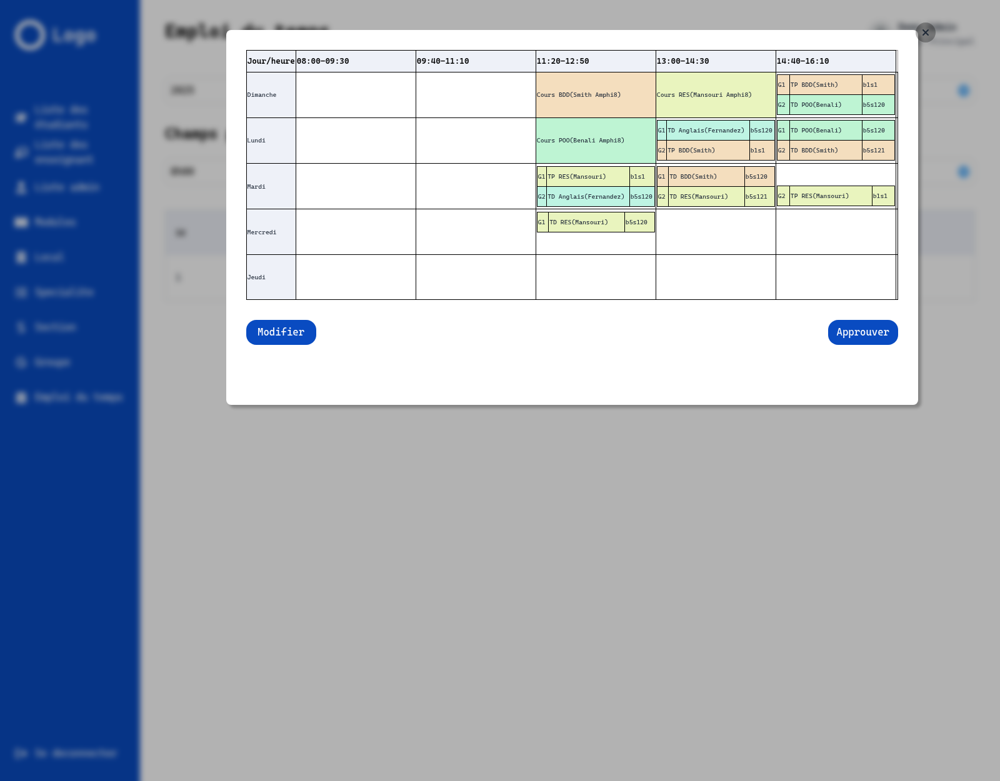

Once saved, a section is marked as generated and can be viewed, edited, deleted, downloaded as Excel or sent by email.

| | |
| --- | --- |
| 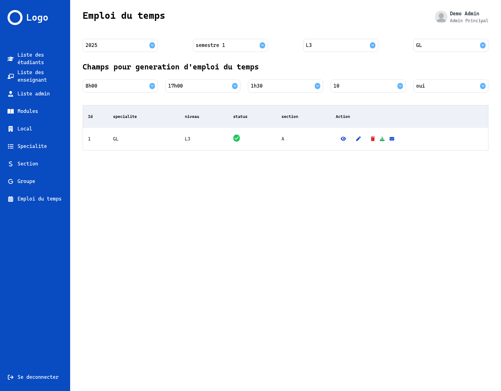 | 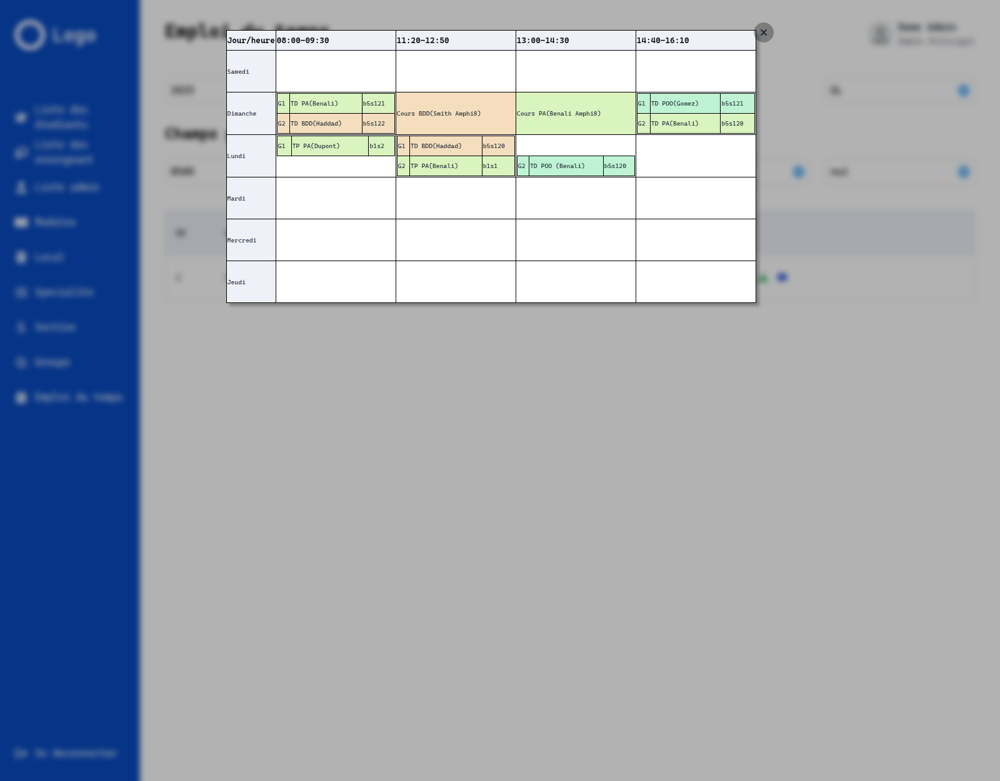 |
| Section marked as generated, with its actions | Saved timetable of a section |

**Teachers**: personal timetable (all the sections they teach) and their unavailable slots, which the generator takes into account.

| | |
| --- | --- |
| 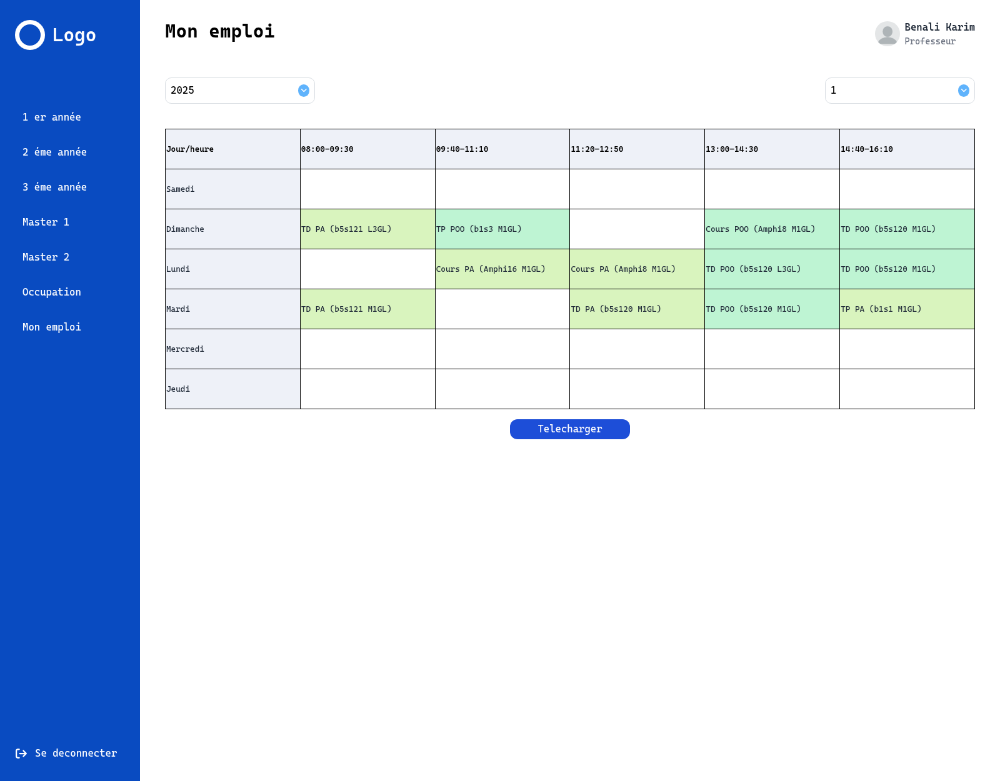 | 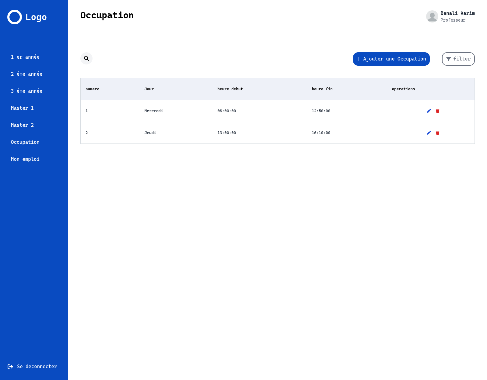 |
| My timetable | Availability (occupations) |

**Students**: browse the timetables by level, year, speciality and semester, and download them.

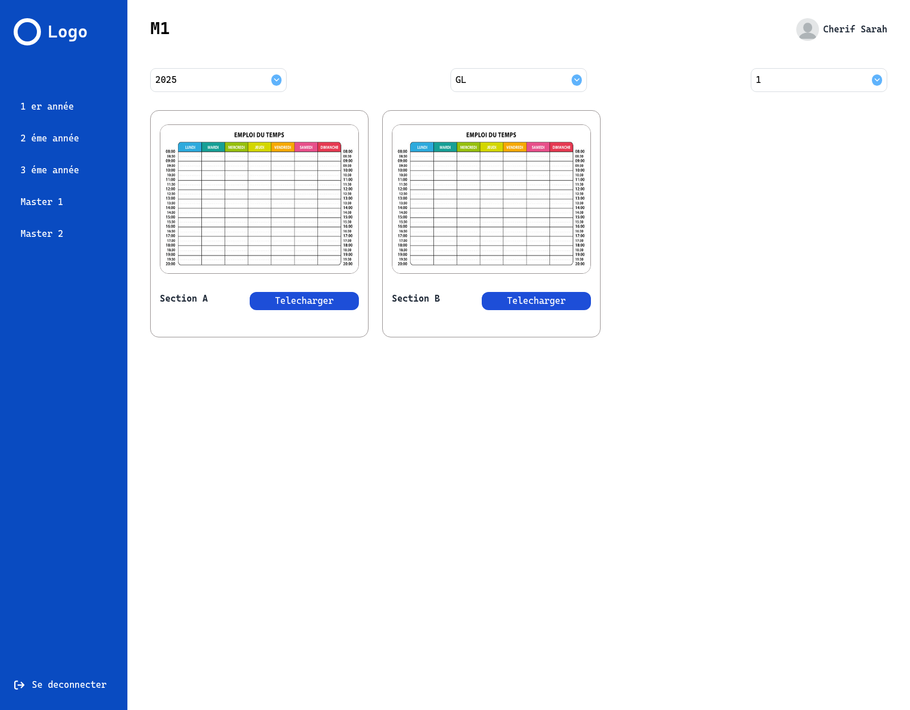

## Tech stack

| Layer | Technologies |
| --- | --- |
| Backend | Node.js, Express, PostgreSQL (`pg-promise`), JWT, bcrypt, Nodemailer, ExcelJS |
| Frontend | React 18, Vite, DaisyUI, Axios, React Router |

## Project structure

```
backend/     Express API (routers, controllers, validators, DB access, generation/)
frontend/    React application (Admin, teacher/student and login pages)
autres/      Design documents: SQL schema and seed data, UML class diagram, specification, Postman/Thunder collections
constants.js Shared enums (roles, room types, session types, weekdays)
```

The relational model, use-case diagram and specification are in [autres/pdf](autres/pdf).

## Getting started

### Prerequisites

Node.js 18+ and PostgreSQL, or just run `nix develop` (see `flake.nix`) to get Node 22 and PostgreSQL.

### 1. Database

```bash
createdb agemp
psql agemp -f autres/DB/creation_agemp_db.sql
psql agemp -f autres/DB/data_agemp_db.sql     # optional sample data (see below)
```

### Sample data

`autres/DB/data_agemp_db.sql` contains two specialities (GL, MI), four sections (GL M1 A and B, MI L2 A, GL L3 A) with their groups, students, teachers, rooms, modules and seances, plus timetables already generated for 2024/2025 (GL M1 A and B semesters 1 and 2, MI L2 semester 2, GL L3 semester 1). Semesters are stored as `1` / `2`, the same values the app uses.

Demo accounts (password `demo1234`):

| Role | Email |
| --- | --- |
| Administrator | admin.demo@example.com |
| Teacher | prof.demo@example.com |
| Student | etudiant.demo@example.com |

### 2. Configure the backend

Copy `backend/.env.example` to `backend/.env` and fill in:

```
ServerPort = 3000
DBHost = localhost
DBPort = 5432
DBName = agemp
DBUser = <user>
DBPass = <password>
JWTSecret = <long random string>
GOOGLE_CLIENT_ID = <client id>
GOOGLE_CLIENT_SECRET = <client secret>
```

`JWTSecret` is required for login. The two `GOOGLE_*` values are only needed for the email feature.

### 3. Run

```bash
npm run createAdmin     # interactive: creates the first administrator
npm run backend         # API on http://localhost:3000
npm run frontend        # app on http://localhost:5000
```

> By default the frontend calls the API at `http://localhost:3000`. To change it, copy `frontend/.env.example` to `frontend/.env` and set `VITE_API_URL` (and `VITE_APP_URL` for the frontend origin).

### Run with Docker

```bash
cp .env.example .env          # set JWTSecret (and the DB credentials if you want)
docker compose up --build     # app on http://localhost:5000, API on http://localhost:3000
docker compose run --rm backend node createAdmin.js   # create the first administrator
```

The database schema is loaded automatically on the first start. To also load the sample data (see "Sample data" below), uncomment the `data_agemp_db.sql` line in `docker-compose.yml` (before the first start, or after `docker compose down -v`). `VITE_API_URL` and `VITE_APP_URL` are baked into the frontend at build time, so rebuild with `docker compose build frontend` after changing them.

## API

Every route except authentication requires a valid JWT cookie, and administrator-only routes are additionally protected. Request collections for testing are in [autres/backend_requetes_test](autres/backend_requetes_test).

## Known limitations

- No automated tests yet.
- No license file has been added.

## Authors

[Lyes Rabhi](https://github.com/lyesrabhi16), [Massin Sadi](https://github.com/MassinS), [Aksil Sadi](https://github.com/AksilSadi) and [Kenza Tikherbatine](https://github.com/Zouzatikher).
